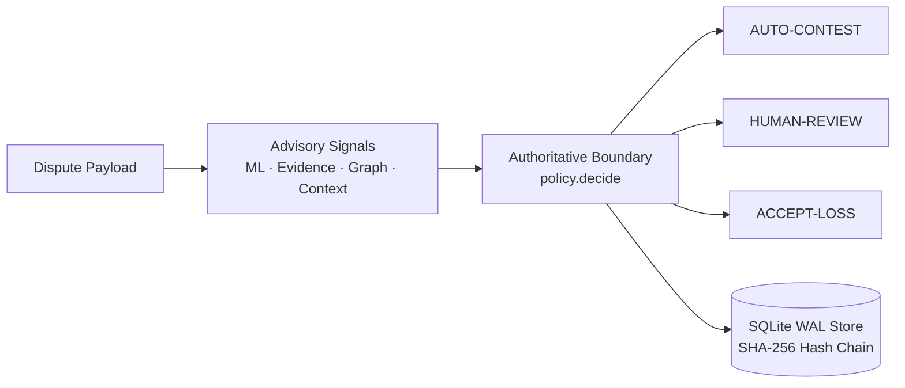
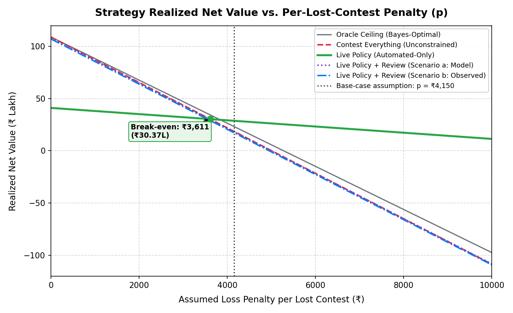

# Chargeback Risk Engine

[](https://github.com/Jagadeesh58/chargeback-risk-engine/actions/workflows/ci.yml)
[](https://www.python.org/downloads/)
[](LICENSE)

> **Status**: Reference implementation evaluated on synthetic data only. Not validated on real payment outcomes. Not legal or compliance advice.

Auditable, evidence-aware chargeback dispute decision system where machine learning and heuristic models provide advisory signals, while a deterministic policy alone routes financial actions (`AUTO-CONTEST`, `HUMAN-REVIEW`, `ACCEPT-LOSS`). All monetary values and evaluations are synthetic. When unpenalized ($p = 0$), contesting every dispute blindly earns higher raw financial recovery (₹108.95 lakh vs ₹41.09 lakh) due to low filing fees; however, under a symmetric per-lost-contest loss penalty, the conservative Live Policy wins once the penalty exceeds ₹3,611.18 (yielding ₹28.77 lakh vs ₹18.64 lakh at base-case penalty $p = ₹4,150).



---

## Quickstart

```bash
# 1. Clean environment install (plain install for runtime; use ".[dev]" for testing)
python -m venv .venv && source .venv/bin/activate  # Windows: .venv\Scripts\activate
pip install -e .

# Optional for development and running test suites:
# pip install -e ".[dev]"

# 2. Start API server in development mode
CHARGEBACK_ENV=development uvicorn chargeback_risk_engine.api:app --host 127.0.0.1 --port 8000

# 3. Authenticated decision request with fail-closed evidence provenance
curl -s -X POST http://127.0.0.1:8000/decision \
  -H "Content-Type: application/json" \
  -H "X-API-Key: test-api-key" \
  -d @examples/request_verified.json
```

---

## Deterministic Decision Rules

Financial actions are chosen strictly by `chargeback_risk_engine.policy.decide()` using thresholds frozen in `artifacts/policy_profile.json`:

| Action | Gate Criteria Required | Operational Rationale |
|---|---|---|
| **AUTO-CONTEST** | Win probability ≥ 0.65<br/>• Evidence completeness ≥ 0.50 (0 unverified fields)<br/>• Graph risk < 0.60<br/>• Amount ≤ ₹50,000 (configurable internal parameter)<br/>• Expected Net Value > 0 (after configurable ₹150 filing fee) | High-probability, evidenced claims automated for recovery without merchant operational overhead. |
| **HUMAN-REVIEW** | Ambiguous probability (0.30 < p < 0.65)<br/>• Missing or unverified evidence provenance<br/>• Network graph risk ≥ 0.60<br/>• Amount > ₹50,000 (configurable ceiling) | Protects against false rejections, dispute penalties, and edge cases requiring human review. |
| **ACCEPT-LOSS** | Win probability ≤ 0.30 **AND** Expected Net Value ≤ 0 | Low-probability disputes where contesting cost (₹150) exceeds expected recovery. |

---

## Configuration Reference

Runtime configuration via environment variables (`Settings` class):

| Variable | Default | Production Requirement |
|---|---|---|
| `CHARGEBACK_ENV` | `production` | Set to `production` (enforces strict security gates; use `development` for local testing). |
| `CHARGEBACK_API_KEY` | `""` | Mandatory 32+ character secret token in production mode. |
| `CHARGEBACK_API_KEYS` | `""` | Optional comma-separated multi-actor credentials (`id:secret:role`). |
| `CHARGEBACK_METRICS_KEY` | `""` | Optional dedicated token for `/metrics` in production mode. |
| `CHARGEBACK_ALLOW_UNVERIFIED_EVIDENCE` | `false` | Must remain `false` in production (ignored/overridden to enforce provenance). |
| `CHARGEBACK_AUDIT_DB_PATH` | `<root>/audit_log.db` | Absolute path outside package directory with persistent storage. |
| `CHARGEBACK_MODEL_PATH` | `<artifacts>/ml_scorer_model.json` | Path to valid model weights with corresponding `.sha256` sidecar file. |
| `CHARGEBACK_CORS_ORIGINS` | `http://localhost:3000...` | Explicit allowed origins (wildcards like `*` are rejected in production). |
| `CHARGEBACK_RATE_LIMIT` | `60` | In-memory requests/minute limit per client key (tunable). |
| `CHARGEBACK_REQUEST_TIMEOUT_SECONDS` | `5.0` | Maximum request execution window in seconds. |

---

## Known Limitations and What This Is Not

- **What this is not**: Not an automated gateway payment executor (creates structured contest drafts, does not auto-submit externally); not a payment processor or acquirer; not legal or compliance advice.
- **Synthetic Circularity**: The bundled dataset is synthetic; models learn distributions embedded in the data generator. Real validation requires processor outcome logs.
- **Storage & Rate Limiting**: The SQLite WAL audit log is optimized for single-host deployments (~50-100 writes/sec); rate limiting is local in-memory per process.
- **Fail-closed behavior**: Any malformed, missing, unverified, or ambiguous input routes to `HUMAN-REVIEW`, never `AUTO-CONTEST`; this behavior is enforced by [tests/test_evidence_provenance.py](tests/test_evidence_provenance.py) and [tests/test_safety_regression.py](tests/test_safety_regression.py).

---

## Key Evaluation Snapshot

*(Evaluated on 5,000 held-out synthetic disputes from `data/test.csv`; synthetic data circular by construction, not a real financial guarantee)*

| Metric | Result |
|---|---:|
| PR-AUC | **0.7234** |
| Auto-contest precision | **77.6%** |
| Auto-contest recall | **36.4%** |
| Realized net value | **₹41.09 lakh (synthetic-only)** |
| Selected policy threshold | **0.65** from `dev.csv` |

Contesting every dispute earns higher raw value at zero loss penalty ($p=0$, ₹108.95 lakh vs ₹41.09 lakh), but the Live Policy wins when the per-lost-contest penalty exceeds the break-even threshold of ₹3,611.18 (yielding ₹28.77 lakh vs ₹18.64 lakh at base-case penalty $p = ₹4,150).

---

## Comprehensive Strategy Comparison & Economic Trade-off Analysis

Evaluated on `data/test.csv` (5,000 held-out disputes) under identical operational cost assumptions (`CONTEST_COST = ₹150`, `HUMAN_REVIEW_COST = ₹50`).

| Strategy | Auto Share | Review Share | Contested Precision | Lost contests (actual or expected) | Net Value (p = 0) | Net Value (p = ₹4,150) | Strategy Notes |
|---|---:|---:|---:|---:|---:|---:|---|
| **Contest Everything** | 100.0% | 0.0% | 56.5% | 2,176 | **₹108.95 lakh** | **₹18.64 lakh** | Blind 100% contesting; ₹150 filing fee; pays penalty on lost disputes |
| **Live Policy (Automated-Only)** | 26.5% | 73.2% | 77.6% | 297 | **₹41.09 lakh** | **₹28.77 lakh** | Conservative automation: high-confidence cases only; reviewed cases valued at ₹0 recovery |
| Live Policy + Human Review (Scenario a: Model Rate) | 26.5% | 73.2% | 56.6% | 2,165 (expected) | **₹108.22 lakh** | **₹18.36 lakh** | Reviewed cases contested at model expected win rate with ₹50 review fee (bound) |
| Live Policy + Human Review (Scenario b: Observed Rate) | 26.5% | 73.2% | 56.6% | 2,164 | **₹107.12 lakh** | **₹17.32 lakh** | Reviewed cases contested at observed held-out win rate with ₹50 review fee (bound) |
| **Theoretical Oracle Ceiling** | 97.2% | 0.0% | 57.5% | 2,065 | **₹109.00 lakh** | **₹23.30 lakh** | Unpenalized Bayes-optimal policy ceiling with hidden state access |

*Note on counts: Contest Everything, Live Policy (Automated-Only), Scenario b (Observed Rate), and Theoretical Oracle Ceiling report exact observed outcomes from the 5,000-case test set. Scenario a (Model Rate) reports expected lost contests by evaluating reviewed cases at the model's calibrated win probability, rounded to a whole number for display.*

### Statistical Comparison & Break-Even Analysis

- **Raw Value Comparison (Unpenalized Baseline, $p=0$)**:
  Contest Everything (unconstrained) achieves the highest raw financial recovery (**₹108.95 lakh**) because the fixed contest cost (₹150) is very low relative to dispute amounts (~₹4,000). The Live Policy achieves **₹41.09 lakh** in conservative automated-only recovery (contesting 26.5% of cases with 77.6% precision) and **₹107.12 lakh** under review scenario b.

- **Bootstrap 95% Confidence Intervals (Resampling Disputes, N=1,000)**:
  1. **Live Policy (Automated-Only) vs. Contest Everything**:
     - At $p = 0$: difference is **-₹67.85 lakh (-₹6,785,415.70)** with 95% CI **[-₹70.83 lakh, -₹64.37 lakh]**.
     - At base-case $p = ₹4,150$: difference is **+₹10.12 lakh (+₹1,012,434.30)** with 95% CI **[+₹4.80 lakh, +₹15.53 lakh]**.
  2. **Live Policy (Scenario b) vs. Contest Everything**:
     - At $p = 0$: difference is **-₹1.82 lakh (-₹182,272.71)** with 95% CI **[-₹1.86 lakh, -₹1.79 lakh]**.
     - At base-case $p = ₹4,150$: difference is **-₹1.32 lakh (-₹132,472.71)** with 95% CI **[-₹1.59 lakh, -₹1.01 lakh]**.

- **Symmetric Break-Even Loss Penalty Level**:
  - **Ranking Flip vs. Automated-Only**: Contest Everything incurs 2,176 lost disputes whereas the Live Policy Automated-Only incurs only 297 (avoiding 1,879 losses). When a symmetric penalty per lost contest is applied to both strategies, Contest Everything falls below Live Policy Automated-Only when the penalty exceeds **₹3,611.18**. At the base-case sensitivity parameter of $p = ₹4,150$ (rupee modelling assumption), the Live Policy yields **₹28.77 lakh** vs Contest Everything's **₹18.64 lakh** (an advantage of **+₹10.12 lakh**).
  - **Ranking Flip vs. Policy with Review (Scenario b)**: In Scenario b, reviewed cases are contested, resulting in 4,984 contested disputes and 2,164 losses (avoiding only 12 losses relative to Contest Everything). Contest Everything falls below Scenario b only if the loss penalty exceeds **₹15,189.39**. Scenarios a and b represent operational upper/lower bounds under full contestation, not proof of review lift.

### Net Value vs. Penalty Sweep



Based on the empirical penalty sweep across penalties from ₹0 to ₹15,000 (verified against `artifacts/strategy_penalty_sweep.json`):
- **Winner at p = 0 (Unpenalized Baseline)**: Contest Everything (Unconstrained) achieves the highest unpenalized recovery (₹108.95L) because filing cost (₹150) is trivial relative to dispute size (~₹4,161).
- **Winner at Base-Case p = ₹4,150**: Live Policy (Automated-Only) achieves ₹28.77L, beating Contest Everything (₹18.64L) by +₹10.12L at base-case penalty p=₹4,150.00.
- **Penalty Above Which Policy Beats Contest Everything**: The Live Policy (Automated-Only) surpasses Contest Everything for all penalties above **₹3,611.18** per lost contest.
- **Human Review Bounds**: Scenarios a and b are theoretical upper bounds because reviewers are assumed to contest 100% of reviewed cases. At base-case p=₹4,150, Scenario b nets ₹17.32L, falling below Contest Everything (₹18.64L) because contesting virtually all cases incurs ₹183,000 in review fees while avoiding only 12 losses.


---

## Project Layout

- `chargeback_risk_engine/` — Core package: advisory ML, evidence assembly, risk graph, deterministic policy, and FastAPI service.
- `tests/` — Test suite: unit, safety invariant, provenance gating, property-based, and integration tests.
- `scripts/` — Evaluation, synthetic data generation, benchmarking, load testing, and report generation utilities.
- `docs/` — Architecture specifications, ADRs, model card, evaluation report, and operational guides.
- `data/` — Synthetic benchmark datasets (`train.csv`, `dev.csv`, `test.csv`, `sample_external_disputes.csv`).
- `artifacts/` — Deterministic model weights, policy profiles, and generated benchmark reports.
- `deploy/` — Production deployment assets, including Prometheus alert rules (`deploy/alert_rules.yml`).
- `examples/` — API request payloads, shell execution scripts, and client integration examples.
- `training/` — Offline model training and temporal evaluation scripts.
- `.github/` — CI/CD workflows (`ci.yml`, `release.yml`), PR/issue templates, and Dependabot config.

---

## How to Reproduce

Run the full local validation suite via `make check`, or run the exact sequence executed in CI:

```bash
ruff check .
ruff format --check .
mypy chargeback_risk_engine
pytest --cov=chargeback_risk_engine --cov-report=term-missing
python scripts/generate_report.py
git diff --exit-code -- README.md artifacts docs ':!docs/*.png'
make verify
pip-audit -r requirements.lock
python -m build
twine check dist/*
```

---

## Documentation Links

- [docs/ARCHITECTURE.md](docs/ARCHITECTURE.md) — System boundaries, data flow, and threat model integration
- [docs/THREAT_MODEL.md](docs/THREAT_MODEL.md) — Threat model, security boundaries, and STRIDE analysis
- [docs/EVALUATION.md](docs/EVALUATION.md) — Full benchmark methodology, ablations, robustness tests, and BYOD harness
- [docs/OPERATIONS.md](docs/OPERATIONS.md) — Deployment and operations notes, backups, anchoring, and measured load tests
- [docs/MODEL_CARD.md](docs/MODEL_CARD.md) — ML model characteristics, features, training data, and offline challengers
- [docs/DATA_DICTIONARY.md](docs/DATA_DICTIONARY.md) — Schema reference for dispute inputs, evidence items, and decisions
- [docs/DECISIONS.md](docs/DECISIONS.md) — Architecture decision records (ADRs)
- [SECURITY.md](SECURITY.md) — Security policy, vulnerability reporting, and hardening checklist

---

## License

This project is licensed under the MIT License — see the [LICENSE](LICENSE) file for details.
