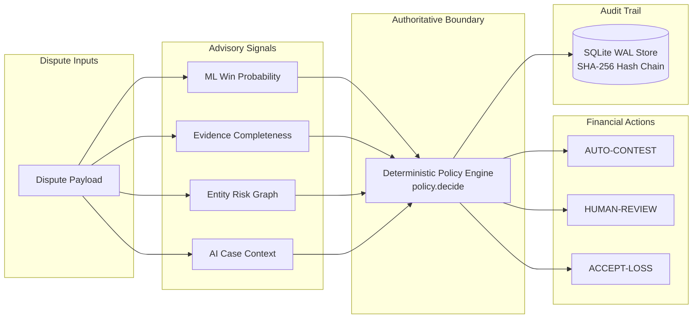

# Chargeback Risk Engine

[](https://github.com/username/chargeback-risk-engine/actions/workflows/ci.yml)
[](https://www.python.org/downloads/)
[](LICENSE)

AI-assisted, evidence-aware chargeback decision system where ML and AI only provide signals, while a deterministic policy alone routes financial actions.



---

## Core Safety Invariants

| Invariant | Rule | Failure Behavior |
|---|---|---|
| **1. Ground before mutating** | Strict input schema validation on types, ranges, reason codes | Rejects request with HTTP 422 |
| **2. Stay in declared scope** | Monetary ceiling enforcement (`MONETARY_CEILING = ₹50,000`) | Routes to `HUMAN-REVIEW` |
| **3. Fresh evidence required** | Completeness verification (`confirmed > 0.50`, 0 unverified fields) | Routes to `HUMAN-REVIEW` |
| **4. Fail closed on anomaly** | Graph network risk threshold (`cluster_score < 0.60`) | Routes to `HUMAN-REVIEW` |
| **5. Positive unit economics** | Expected net value gate ($EV > 0$ after filing fee ₹150) | Routes to `ACCEPT-LOSS` |
| **6. Immutable audit trail** | Append-only SQLite WAL table with SHA-256 hash chaining | Aborts write on integrity failure |

---

## Deterministic Policy Decision Rules

Financial actions are chosen exclusively by `chargeback_risk_engine.policy.decide()`:

| Action | Gate Criteria Required | Operational Rationale |
|---|---|---|
| **AUTO-CONTEST** | Win probability $\ge 0.65$<br/>• Evidence quality $> 0.50$ (0 unverified fields)<br/>• Graph risk $< 0.60$<br/>• Amount $\le ₹50,000$<br/>• Expected Net Value $> 0$ | High-probability, fully evidenced claims automated for recovery without merchant operational overhead. |
| **HUMAN-REVIEW** | Ambiguous probability (0.30 < p < 0.65)<br/>• Missing or unverified evidence<br/>• Network graph risk $\ge 0.60$<br/>• Amount $> ₹50,000$ | Protects against false rejections, compliance penalties, and edge-case disputes needing human judgment. |
| **ACCEPT-LOSS** | Win probability $\le 0.30$ **AND** Expected Net Value $\le 0$ | Low-probability disputes where contesting cost (₹150) exceeds expected recovery. |

---

## Quickstart

```bash
# 1. Install dependencies in editable mode
pip install -e ".[dev]"

# 2. Run REST API server (or via unified CLI: chargeback-cli serve)
uvicorn chargeback_risk_engine.api:app --host 0.0.0.0 --port 8000

# 3. Launch interactive demo
chargeback-demo
# or launch Streamlit UI: streamlit run scripts/demo.py

# 4. Verify cryptographic audit chain integrity
chargeback-cli verify-audit

# 5. Evaluate an external dispute dataset
chargeback-cli evaluate --csv data/sample_external_disputes.csv
```

---

## Key Evaluation Snapshot

*(Evaluated on 5,000 held-out synthetic test disputes; synthetic evaluation only, not a production performance guarantee)*

| Metric | Result |
|---|---:|
| PR-AUC | **0.7234** |
| Auto-contest precision | **77.6%** |
| Auto-contest recall | **36.4%** |
| Realized net value | **₹41.09 lakh (synthetic-only)** |
| Selected policy threshold | **0.65** from `dev.csv` |

---

## Comprehensive Strategy Comparison & Economic Trade-off Analysis

Evaluated on `data/test.csv` (5,000 held-out disputes) under identical operational cost assumptions (`CONTEST_COST = ₹150`, `HUMAN_REVIEW_COST = ₹50`).

| Strategy | Auto Share | Review Share | Contested Precision | Lost Contests | Net Value (p = 0) | Net Value (p = ₹4,150) | Strategy Notes |
|---|---:|---:|---:|---:|---:|---:|---|
| **Contest Everything** | 100.0% | 0.0% | 56.5% | 2,176 | **₹108.95 lakh** | **₹18.64 lakh** | Blind 100% contesting; ₹150 filing fee; pays penalty on lost disputes |
| **Live Policy (Automated-Only)** | 26.5% | 73.2% | 77.6% | 297 | **₹41.09 lakh** | **₹28.77 lakh** | Conservative automation: high-confidence cases only; reviewed cases valued at ₹0 recovery |
| Live Policy + Human Review (Scenario a: Model Rate) | 26.5% | 73.2% | 56.6% | 2,165.2 | **₹108.22 lakh** | **₹18.36 lakh** | Reviewed cases contested at model expected win rate with ₹50 review fee (bound) |
| Live Policy + Human Review (Scenario b: Observed Rate) | 26.5% | 73.2% | 56.6% | 2,164 | **₹107.12 lakh** | **₹17.32 lakh** | Reviewed cases contested at observed held-out win rate with ₹50 review fee (bound) |
| **Theoretical Oracle Ceiling** | 97.2% | 0.0% | 57.5% | 2,065 | **₹109.00 lakh** | **₹23.30 lakh** | Unpenalized Bayes-optimal policy ceiling with hidden state access |

### Statistical Comparison & Break-Even Analysis

- **Bootstrap 95% Confidence Intervals (Resampling Disputes, N=1,000)**:
  - Automated-Only vs. Contest Everything ($p = 0$): Difference is **-₹67.85 lakh** with 95% CI **[-₹70.83 lakh, -₹64.37 lakh]**.
  - Automated-Only vs. Contest Everything ($p = ₹4,150$): Difference is **+₹10.12 lakh** with 95% CI **[+₹4.80 lakh, +₹15.53 lakh]**.
  - Scenario b vs. Contest Everything ($p = 0$): Difference is **-₹1.82 lakh** with 95% CI **[-₹1.86 lakh, -₹1.79 lakh]**.
  - Scenario b vs. Contest Everything ($p = ₹4,150$): Difference is **-₹1.32 lakh** with 95% CI **[-₹1.59 lakh, -₹1.01 lakh]**.
- **Symmetric Break-Even Loss Penalty Level**:
  - Live Policy (Automated-Only) flips above Contest Everything when the penalty exceeds **₹3,611.18**.
  - Scenario b flips above Contest Everything when the penalty exceeds **₹15,189.39**.
- **Empirical Snapshot**:
  - Auto-Contest Decisions: 1,324
  - Precision: 77.6% [75.3%, 79.8%]
  - Net Recovery: ₹26.58 Lakh [₹24.96 Lakh, ₹28.21 Lakh]

---

## Security & Known Limitations

- **Synthetic Evaluation**: Benchmark figures are generated from synthetic dispute distributions and do not represent production performance guarantees.
- **Fail-Closed Boundary**: Ambiguous, incomplete, or corrupted inputs route to `HUMAN-REVIEW`.
- **Authoritative Separation**: Machine learning, graph clustering, and AI models produce advisory signals only.
- **References**: Review our [SECURITY.md](SECURITY.md), [OPERATIONS.md](OPERATIONS.md), and [docs/THREAT_MODEL.md](docs/THREAT_MODEL.md) for detailed policies.
