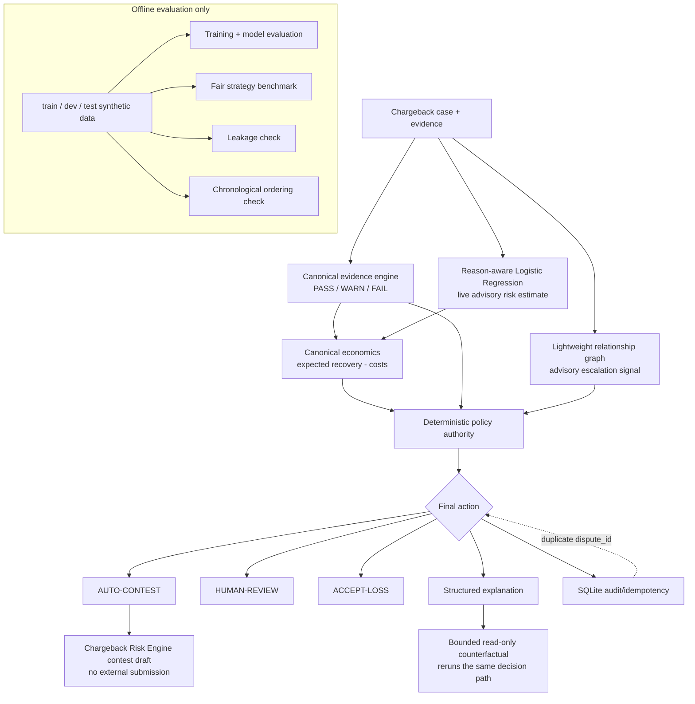

# Architecture

Chargeback Risk Engine maintains a single canonical decision path across the REST API, CLI tools, evaluation benchmark, and counterfactual analysis.



## Decision Flow

1. **Request Validation**: The request is validated against strict Pydantic schemas at the API boundary.
2. **Evidence Evaluation**: The canonical evidence engine evaluates reason-relevant fields as `PASS`, `WARN`, or `FAIL` with fail-closed provenance verification.
3. **Advisory Risk Estimation**: Calibrated Logistic Regression models estimate contest-win probability. This estimate is purely advisory.
4. **Relationship Graph**: A lightweight graph detects high-degree suspicious clusters and syndicates via a 2-hop bounded CTE query. This signal is advisory.
5. **Canonical Economics**: Computes expected recovery and expected net value from the case amount and risk estimate under modeled filing fees.
6. **Deterministic Policy Authority**: The deterministic policy layer applies safety, value, and evidence gates in fixed order. ML/AI cannot override policy gates.
7. **Action Selection**: The engine returns exactly one action: `AUTO-CONTEST`, `HUMAN-REVIEW`, or `ACCEPT-LOSS`.
8. **Contest Draft**: A structured representation packet is compiled only for `AUTO-CONTEST`.
9. **Explanation & Counterfactual**: Records rationale and minimal evidence modification needed to flip an adverse decision.
10. **Cryptographic Audit Log**: Persisted in an append-only SQLite hash chain with SHA-256 links; duplicate requests return idempotent replays.

## Why Not Contest Everything?

In unconstrained spreadsheet arithmetic, contesting every dispute appears attractive whenever expected value exceeds the nominal gateway fee ($p \times \text{amount} - \text{fee} > 0$, typically $p > 3.75\%$). However, production dispute operations are not risk-free bets:

1. **Dispute Monitoring Programs**: Payment networks operate merchant monitoring programs that apply operational surcharges or remediation requirements when dispute or fraud ratios exceed established thresholds.
2. **Arbitration Exposure**: Representments that escalate to network arbitration can carry additional fees and operational cost; amounts and terms vary by network and acquirer contract.
3. **Acquiring Termination**: Persistent adverse dispute loss rates risk processor termination and merchant account closure.

For these reasons, the engine enforces strict, evidence-backed gating: only claims with verified, high-quality documentation are auto-contested, while ambiguous or high-risk cases fail closed to human review.

## Single Canonical Path

The authoritative entry point is:

```python
from chargeback_risk_engine.engine.hybrid_pipeline import decide_case

result = decide_case(dispute)
```

The following components all call `decide_case(...)`:

- FastAPI `/decision` endpoint
- CLI evaluation and demo scripts (`scripts/demo.py`, `scripts/evaluate_real_data.py`)
- Strategy benchmark (`scripts/benchmark.py`)

## Core Module Boundaries

| Component | Role | Authority |
|---|---|---|
| `ml_scorer.py` | Predicts win probability from calibrated features | Advisory signal only |
| `evidence_score.py` | Validates completeness and provenance of evidence packet | Advisory signal only |
| `risk_graph.py` | Identifies entity sharing across disputes | Advisory signal only |
| `economic_decision.py` | Models financial expectation minus representment fees | Advisory signal only |
| `ai_analyst.py` | Heuristic LLM-style policy critique and fraud notes | Advisory signal only |
| `policy.py` | Evaluates business rules and selects final action | **Sole financial decision authority** |
| `audit_log.py` | Cryptographically hashes and records all decisions | Append-only audit store |
