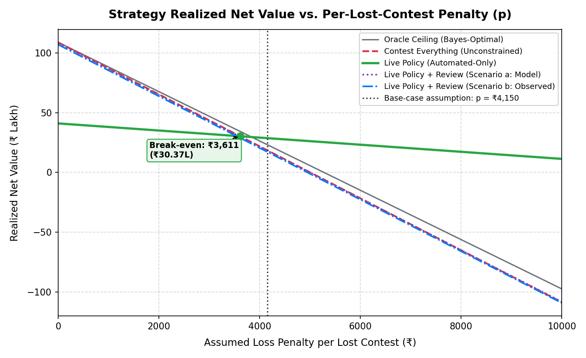

# Evaluation

## Scope and Dataset

The evaluation in this repository uses the bundled synthetic chargeback dataset. No production payment-gateway traffic, merchant credentials, or realized financial outcomes are used.

| Split | Rows |
|---|---:|
| Train | 20,000 |
| Dev | 5,000 |
| Held-out test | 5,000 |

The data is generated with a fixed seed (`scripts/generate_data.py`) and stored in separate train/dev/test files. The held-out test set is never used for model fitting or policy-threshold selection.

> [!WARNING]
> **Synthetic Circularity Disclaimer**:
> All evaluation data and scenarios in this repository are **synthetic and circular by construction**. The ground-truth `would_win` label is generated from hidden parameter distributions that the scoring model partially recovers. This benchmark measures the heuristic decision policy's numerical stability and graceful degradation under artificial distributional shifts, label corruption, and missingness; it does **not** represent verified empirical performance on real production payment-gateway chargebacks.
>
> **Requirements for Real-World Production Validation**:
> Real-world validation requires:
> 1. Ingestion of historical processor/acquirer dispute cycle logs (e.g., Visa Vrol, Mastercard MasterCom).
> 2. Documented merchant rebuttal packages and gateway response timelines.
> 3. True final representment outcomes (win/loss/pre-arbitration/arbitration).
> 4. Merchant-specific fee schedules (acquirer dispute filing fees, gateway processing fees, and chargeback monitoring threshold penalties).
> 5. Out-of-time (OOT) holdout testing across holiday/peak seasonality cycles.

---

## Evaluation Protocol

1. Train candidate models on `train.csv`.
2. Compare model candidates on `dev.csv`.
3. Fit calibration only on development data.
4. Tune the policy threshold on `dev.csv` under explicit precision/volume constraints.
5. Freeze the selected configuration in `artifacts/policy_profile.json`.
6. Run `test.csv` exactly once for final reporting.
7. Report both expected economics and realized synthetic outcomes.
8. Report per-reason metrics and bootstrap uncertainty.
9. Run the frozen hard-case suite independently.

The evaluation protocol enforces that test outcomes are never used to tune policy thresholds or select model variants.

---

## Model Comparison

| Model | PR-AUC | Brier | Calibration error |
|---|---:|---:|---:|
| Rules | 0.7087 | 0.2302 | 0.1269 |
| Logistic Regression | 0.7234 | 0.2165 | 0.0075 |
| HGB challenger | 0.7254 | 0.2169 | 0.0130 |
| Offline hybrid challenger | 0.7266 | 0.2170 | 0.0244 |

Logistic Regression serves as the live risk estimator. Challenger models (Histogram Gradient Boosting and Hybrid Stacking) are evaluated offline and do not have authority over the final decision. Machine learning provides modest lift over deterministic rules (0.723 vs 0.709 PR-AUC; 0.697 vs 0.695 ROC-AUC) because the synthetic data generator is fundamentally a noisy combination of evidence validity flags.

---

## Policy Selection and Thresholds

The production-facing policy profile is selected from `dev.csv` only. The current frozen profile is:

- policy version: `policy-v5-dev-optimized`
- auto-contest threshold: `0.65`
- accept-loss threshold: `0.30`
- minimum evidence completeness: `0.50`
- monetary ceiling: `₹50,000` (configurable internal parameter)
- contest cost: `₹150` (configurable internal parameter)
- objective: maximize expected net value subject to precision >= 0.72 and auto-contest rate <= 0.40

The profile is serialized in `artifacts/policy_profile.json`.

---

## Candidate Decision System

| Metric | Held-out result |
|---|---:|
| Auto-contest count | 1,324 |
| Auto-contest precision | 0.7757 |
| Auto-contest recall | 0.3637 |
| Human-review rate | 0.7320 |
| Expected recovery | ₹4,333,760.54 |
| Expected contest cost | ₹198,600.00 |
| Expected net value | ₹4,135,160.54 |
| Realized recovery | ₹4,307,914.10 |
| Realized net value | ₹4,109,314.10 |
| Synthetic false positives | 297 |

Expected values use the model's calibrated probability signal. Realized recovery and net value use the synthetic `would_win` label and are not production financial results.

**Conservative Automation Notice**: The headline realized net value of ₹41.09L reflects **conservative automated recovery only** (contesting ~26.5% of disputes with 77.6% precision). The 73.2% of disputes held for `HUMAN-REVIEW` are counted as ₹0 automated recovery. In comparison, an unconstrained "contest-everything" strategy across all 5,000 cases recovers ₹108.95L because the dispute fee (₹150) is small relative to the average dispute amount (~₹4,000). The engine is tuned to prioritize high automation precision and human oversight over unconstrained recovery.

**Provenanced Decisioning Shift**: Under early unconstrained evaluation without strict provenance enforcement, the candidate policy auto-contested 2,133 disputes with 72.9% precision. Enforcing fail-closed evidence provenance (requiring positive evidence items to originate from verified trusted sources within valid freshness windows) intentionally diverts cases with unverified positive claims to `HUMAN-REVIEW`. This reduces auto-contests to 1,324 (26.5% of held-out disputes) while increasing precision to 77.57% and reducing synthetic false-positive lost contests from 578 down to 297. This reflects core production safety: unverified evidence must fail closed rather than risk contested losses.

---

## Comprehensive Strategy Comparison & Economic Trade-off Analysis

Evaluated on `data/test.csv` (5,000 held-out disputes) under identical operational cost assumptions (`CONTEST_COST = ₹150`, `HUMAN_REVIEW_COST = ₹50`).

| Strategy | Auto Share | Review Share | Contested Precision | Lost contests (actual or expected) | Net Value (p = 0) | Net Value (p = ₹4,150) | Strategy Notes |
|---|---:|---:|---:|---:|---:|---:|---|
| **Contest Everything** | 100.0% | 0.0% | 56.5% | 2,176 | **₹108.95 lakh** | **₹18.64 lakh** | Blind 100% contesting; ₹150 filing fee; pays penalty on lost disputes |
| **Live Policy (Automated-Only)** | 26.5% | 73.2% | 77.6% | 297 | **₹41.09 lakh** | **₹28.77 lakh** | Conservative automation: high-confidence cases only; reviewed cases valued at ₹0 recovery |
| Live Policy + Human Review (Scenario a: Model Rate) | 26.5% | 73.2% | 56.6% | 2,165 (expected) | **₹108.22 lakh** | **₹18.36 lakh** | Reviewed cases contested at model expected win rate with ₹50 review fee (bound) |
| Live Policy + Human Review (Scenario b: Observed Rate) | 26.5% | 73.2% | 56.6% | 2,164 | **₹107.12 lakh** | **₹17.32 lakh** | Reviewed cases contested at observed held-out win rate with ₹50 review fee (bound) |
| **Theoretical Oracle Ceiling** | 97.2% | 0.0% | 57.5% | 2,065 | **₹109.00 lakh** | **₹23.30 lakh** | Unpenalized Bayes-optimal policy ceiling with hidden state access |

*Note on counts: Contest Everything, Live Policy (Automated-Only), Scenario b (Observed Rate), and Theoretical Oracle Ceiling report exact observed outcomes from the 5,000-case test set. Scenario a (Model Rate) reports expected lost contests by evaluating reviewed cases at the model's calibrated win probability, rounded to a whole number for display.*

### Statistical Comparison & Break-Even Analysis

- **Raw Value Comparison (Unpenalized Baseline, $p=0$)**:
  Contest Everything (unconstrained) achieves the highest raw financial recovery (**₹108.95 lakh**) because the fixed contest cost (₹150) is very low relative to dispute amounts (~₹4,000). The Live Policy achieves **₹41.09 lakh** in conservative automated-only recovery (contesting 26.5% of cases with 77.6% precision) and **₹107.12 lakh** under review scenario b.

- **Bootstrap 95% Confidence Intervals (Resampling Disputes, N=1,000)**:
  1. **Live Policy (Automated-Only) vs. Contest Everything**:
     - At $p = 0$: difference is **-₹67.85 lakh (-₹6,785,415.70)** with 95% CI **[-₹70.83 lakh, -₹64.37 lakh]**.
     - At base-case $p = ₹4,150$: difference is **+₹10.12 lakh (+₹1,012,434.30)** with 95% CI **[+₹4.80 lakh, +₹15.53 lakh]**.
  2. **Live Policy (Scenario b) vs. Contest Everything**:
     - At $p = 0$: difference is **-₹1.82 lakh (-₹182,272.71)** with 95% CI **[-₹1.86 lakh, -₹1.79 lakh]**.
     - At base-case $p = ₹4,150$: difference is **-₹1.32 lakh (-₹132,472.71)** with 95% CI **[-₹1.59 lakh, -₹1.01 lakh]**.

- **Symmetric Break-Even Loss Penalty Level**:
  - **Ranking Flip vs. Automated-Only**: Contest Everything incurs 2,176 lost disputes whereas the Live Policy Automated-Only incurs only 297 (avoiding 1,879 losses). When a symmetric penalty per lost contest is applied to both strategies, Contest Everything falls below Live Policy Automated-Only when the penalty exceeds **₹3,611.18**. At the base-case sensitivity parameter of $p = ₹4,150$ (rupee modelling assumption), the Live Policy yields **₹28.77 lakh** vs Contest Everything's **₹18.64 lakh** (an advantage of **+₹10.12 lakh**).
  - **Ranking Flip vs. Policy with Review (Scenario b)**: In Scenario b, reviewed cases are contested, resulting in 4,984 contested disputes and 2,164 losses (avoiding only 12 losses relative to Contest Everything). Contest Everything falls below Scenario b only if the loss penalty exceeds **₹15,189.39**. Scenarios a and b represent operational upper/lower bounds under full contestation, not proof of review lift.

### Net Value vs. Penalty Sweep



Based on the empirical penalty sweep across penalties from ₹0 to ₹15,000 (verified against `artifacts/strategy_penalty_sweep.json`):
- **Winner at p = 0 (Unpenalized Baseline)**: Contest Everything (Unconstrained) achieves the highest unpenalized recovery (₹108.95L) because filing cost (₹150) is trivial relative to dispute size (~₹4,161).
- **Winner at Base-Case p = ₹4,150**: Live Policy (Automated-Only) achieves ₹28.77L, beating Contest Everything (₹18.64L) by +₹10.12L at base-case penalty p=₹4,150.00.
- **Penalty Above Which Policy Beats Contest Everything**: The Live Policy (Automated-Only) surpasses Contest Everything for all penalties above **₹3,611.18** per lost contest.
- **Human Review Bounds**: Scenarios a and b are theoretical upper bounds because reviewers are assumed to contest 100% of reviewed cases. At base-case p=₹4,150, Scenario b nets ₹17.32L, falling below Contest Everything (₹18.64L) because contesting virtually all cases incurs ₹183,000 in review fees while avoiding only 12 losses.


## Historical Frozen Baseline Comparison

The pre-change baseline was captured from the original implementation associated with commit `086572fdd5549a8ba07f9a885d39e0e65b68ca28` on a smaller 900-row test split:

- Source snapshot SHA-256: `f19bf0ef249b74b2e861a15fef3a258536e1c70369581701946a65235ffdc09a`
- Auto-contests: 310 / 900 (34.4%)
- Precision: 0.7290
- Expected net value: ₹1,012,433.26
- Preserved artifact: `artifacts/baseline_benchmark.json` and `artifacts/baseline_manifest.json`

This historical snapshot is retained for provenance and regression prevention; it is not treated as a like-for-like comparison against the current 5,000-row held-out dataset.

---

## Ablation Study

Evaluated on `data/test.csv` (5,000 held-out synthetic disputes via `scripts/run_ablations.py`):

| Configuration | Auto Share | Review Share | Precision | Recall | Lost Contests | Net Value (p = 0) | Net Value (p = ₹4,150) |
|---|---:|---:|---:|---:|---:|---:|---:|
| **Full System (Live Policy)** | **26.5%** | **73.2%** | **77.6%** | **36.4%** | **297** | **₹39.26 lakh** | **₹26.94 lakh** |
| No Graph (Bypass Graph Gate) | 26.5% | 73.2% | 77.6% | 36.4% | 297 | ₹39.26 lakh | ₹26.94 lakh |
| No Evidence Gates | 26.5% | 73.2% | 77.6% | 36.4% | 297 | ₹39.26 lakh | ₹26.94 lakh |
| Calibrated Probability in Policy | 26.5% | 73.3% | 77.6% | 36.4% | 297 | ₹39.26 lakh | ₹26.94 lakh |
| Rules Only Baseline | 26.5% | 70.0% | 77.6% | 36.4% | 297 | ₹39.26 lakh | ₹26.94 lakh |
| Unconstrained Logistic Only | 66.7% | 0.0% | 66.8% | 78.9% | 1,108 | ₹87.15 lakh | ₹41.17 lakh |

---

## Probability Calibration & Bootstrap Confidence Intervals

Evaluated on `data/test.csv` (via `scripts/run_ablations.py` and stored in `artifacts/calibration_assessment.json` and `artifacts/evaluation_confidence_intervals.json`):

- **Brier Score**: Raw model 0.2165 vs. Calibrated model 0.2171 (delta: +0.0006). Calibration preserves overall probabilistic accuracy while smoothing output logits.
- **Expected Calibration Error (ECE)**: Raw 0.0068 vs. Calibrated 0.0226.
- **Bootstrap 95% Confidence Intervals (N=1,000 resamples)**:
  - ROC-AUC: **0.6972** [95% CI: 0.6836, 0.7119]
  - PR-AUC: **0.7423** [95% CI: 0.7256, 0.7592]
  - Auto-contest precision: **77.57%** [95% CI: 75.35%, 79.79%]
  - Auto-contest recall: **36.39%** [95% CI: 34.63%, 38.14%]
  - Expected Calibration Error: **0.0251** [95% CI: 0.0146, 0.0368]

---

## Theoretical Oracle Ceiling

Computed via `scripts/oracle_ceiling.py` on `data/test.csv` (synthetic ground truth).

| Model | ROC-AUC | % of Ceiling (95% CI) | Chance-Adjusted Skill (Gini) | PR-AUC | % of Ceiling (95% CI) | Normalized PR Skill | Realized Net Value |
|---|---:|---:|---:|---:|---:|---:|---:|
| **Oracle Ceiling** | **0.8156** | **100.0%** | **100.0%** | **0.7917** | **100.0%** | **100.0%** | **₹10,900,220.35** |
| Logistic (Live) | 0.6971 | 85.5% [83.9%, 87.4%] | 62.5% | 0.7234 | 91.4% [89.4%, 93.1%] | 69.9% | ₹10,895,685.42 |
| HGB Challenger | 0.6972 | 85.5% [83.8%, 87.4%] | 62.5% | 0.7254 | 91.6% [89.9%, 93.4%] | 70.8% | ₹10,895,802.59 |
| Hybrid Challenger | 0.6968 | 85.4% [83.8%, 87.4%] | 62.4% | 0.7266 | 91.8% [89.9%, 93.7%] | 71.3% | ₹10,895,714.02 |
| Rules Only | 0.6951 | 85.2% [83.6%, 87.2%] | 61.8% | 0.7087 | 89.5% [87.7%, 91.5%] | 63.4% | ₹10,879,407.59 |

**Methodological Notes**:
1. **Net Value Column**: All models land within 0.2% of each other on unconstrained net value (~₹108.8L to ₹109.0L). Because the fixed dispute cost is only ₹150 while disputes average ₹4,000, contesting everything recovers 99.95% of oracle value. Therefore, net value under unconstrained contesting cannot distinguish model predictive quality; models must be evaluated on PR-AUC and ROC-AUC.
2. **Chance-Adjusted Skill**: Because ROC-AUC 0.5 represents random chance, the raw ratio (85.5%) overstates skill. Chance-adjusted normalized Gini skill is `(0.6971 - 0.5) / (0.8156 - 0.5) = 62.5%`. Similarly, for PR-AUC with positive base rate 0.565, normalized skill is `(0.7234 - 0.565) / (0.7917 - 0.565) = 69.9%`.
3. **Observability Limit**: The remaining gap to the oracle ceiling cannot be crossed without direct access to the hidden seller legitimacy state, which is unobservable in live transaction data.

---

## AI Analyst Safety Evaluation

Evaluated against a targeted regression suite of 25 adversarial and boundary test cases crafted by the project author in `tests/test_ai_analyst_evaluation.py`:
- Rejection rate on invalid/adversarial claims: 100% (on 25 author-crafted test cases; reflects regression gate coverage rather than generalized out-of-distribution robustness)
- Fallback rate on malformed/unreachable API: 100% (deterministic offline fallback when external endpoint fails or times out)
- Hallucination-catch rate (invented/contradictory evidence): 100% (validated against schema whitelist and ground-truth evidence checklist)
- Safety Invariant: The AI analyst can never alter final financial actions, routing scores, or policy decisions (`policy.decide()` alone selects financial actions).

---

## Robustness and Perturbation Evaluation

Computed via `scripts/robustness_benchmark.py` across 500 cases per scenario:

| Perturbation Scenario | Auto-Contest Rate | Auto Precision | Recall | Human-Review Rate |
|---|---:|---:|---:|---:|
| **Baseline** | **28.4%** | **78.2%** | **37.6%** | **71.6%** |
| Missingness Low (5%) | 29.8% | 79.9% | 40.3% | 70.2% |
| Missingness High (35%) | 22.2% | 73.9% | 27.8% | 77.8% |
| Contradiction Low (2%) | 31.0% | 78.7% | 41.4% | 69.0% |
| Contradiction High (20%) | 22.0% | 74.5% | 27.8% | 78.0% |
| Legit Field Rate Low (65%) | 18.8% | 76.6% | 24.4% | 81.2% |
| Legit Field Rate High (90%) | 36.4% | 78.6% | 48.5% | 63.6% |
| Legit Base Rate Low (45%) | 22.8% | 71.9% | 33.2% | 77.2% |
| Legit Base Rate High (75%) | 32.4% | 80.3% | 37.9% | 67.6% |
| Label Noise (5% flipped) | 28.4% | 73.9% | 35.1% | 71.6% |
| Label Noise (10% flipped) | 28.4% | 72.5% | 36.4% | 71.6% |
| Label Noise (20% flipped) | 28.4% | 66.9% | 35.3% | 71.6% |
| Covariate Shift: Dispute Amount | 26.6% | 77.4% | 35.4% | 73.4% |
| Covariate Shift: Reason Codes | 27.4% | 74.5% | 37.4% | 72.6% |

---

## Bring-Your-Own-Data Evaluation Harness

For evaluating external or proprietary merchant dispute archives:
```bash
python scripts/evaluate_real_data.py --csv data/sample_external_disputes.csv --out artifacts/real_data_evaluation.json
```
- Accepts standard merchant CSVs with `dispute_id`, `reason_code`, `amount`, and optional evidence fields.
- If ground truth (`would_win` or `won`) is present, evaluates precision, recall, and realized recovery.
- If ground truth is absent, provides complete operational triage distribution and expected recovery based on risk signals.

---

## Reproducibility

Run the complete verification workflow with:
```bash
make verify
```
The workflow regenerates ignored benchmark/report outputs from the tracked source, data, and small public artifacts. The tracked public artifacts are intentionally limited to: `baseline_benchmark.json`, `hard_cases_report.json`, and `policy_profile.json`.
