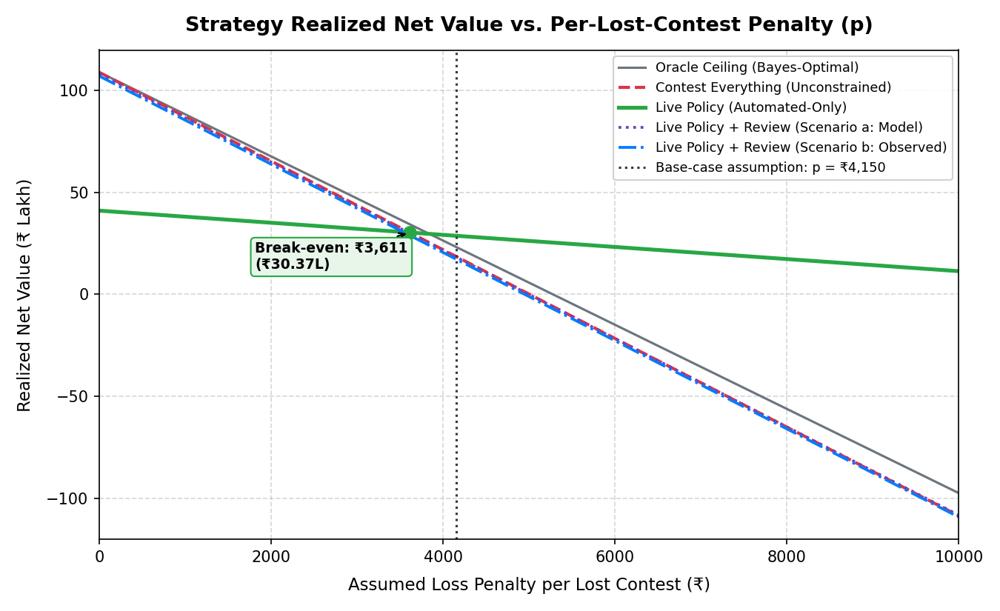

# Model Card

## Intended use

Rank the likely success of a merchant chargeback dispute so downstream policy can decide whether to contest automatically, route to a human, or accept the loss.

## Model

The live model is a reason-code-specific Logistic Regression model trained only on relevant evidence fields. Unknown fields are explicitly encoded as uncertainty (0.5) rather than silently treated as positive evidence.

Rules and the HistGradientBoosting challenger (PR-AUC 0.7254) are retained for offline comparison.

## Evaluation protocol

- train: `data/train.csv` (20,000 rows)
- model-selection / calibration: `data/dev.csv` (5,000 rows)
- final evaluation: `data/test.csv` (5,000 rows)
- no `would_win` value is supplied to the live scorer
- policy tuning is performed on development data only

## Current result

The bundled test snapshot reports:
- PR-AUC: **0.7234** (vs. rules baseline 0.7087, HGB challenger 0.7254, and theoretical oracle ceiling 0.7917)
- ROC-AUC: **0.6971** (vs. rules baseline 0.6951 and theoretical oracle ceiling 0.8156)
- Normalized Chance-Adjusted Skill: **62.5%** of oracle Gini skill; **69.9%** of oracle normalized PR skill
- Policy operating point (0.65 threshold): 77.6% precision and 36.4% recall
- Automated realized net value: **₹41.09L** (conservative automation with 73.2% held for manual review valued at ₹0)

## Strategy comparison & economic trade-offs

Evaluated on `data/test.csv` (5,000 held-out disputes) under identical operational cost assumptions (`CONTEST_COST = ₹150`, `HUMAN_REVIEW_COST = ₹50`).

| Strategy | Auto Share | Review Share | Contested Precision | Lost Contests | Net Value (p = 0) | Net Value (p = ₹4,150) | Strategy Notes |
|---|---:|---:|---:|---:|---:|---:|---|
| **Contest Everything** | 100.0% | 0.0% | 56.5% | 2,176 | **₹108.95 lakh** | **₹18.64 lakh** | Blind 100% contesting; ₹150 filing fee; pays penalty on lost disputes |
| **Live Policy (Automated-Only)** | 26.5% | 73.2% | 77.6% | 297 | **₹41.09 lakh** | **₹28.77 lakh** | Conservative automation: high-confidence cases only; reviewed cases valued at ₹0 recovery |
| Live Policy + Human Review (Scenario a: Model Rate) | 26.5% | 73.2% | 56.6% | 2,165.2 | **₹108.22 lakh** | **₹18.36 lakh** | Reviewed cases contested at model expected win rate with ₹50 review fee (bound) |
| Live Policy + Human Review (Scenario b: Observed Rate) | 26.5% | 73.2% | 56.6% | 2,164 | **₹107.12 lakh** | **₹17.32 lakh** | Reviewed cases contested at observed held-out win rate with ₹50 review fee (bound) |
| **Theoretical Oracle Ceiling** | 97.2% | 0.0% | 57.5% | 2,065 | **₹109.00 lakh** | **₹23.30 lakh** | Unpenalized Bayes-optimal policy ceiling with hidden state access |

### Statistical Comparison & Break-Even Analysis

- **Raw Value Comparison (Unpenalized Baseline, $p=0$)**:
  Contest Everything (unconstrained) achieves the highest raw financial recovery (**₹108.95 lakh**) because the fixed contest cost (₹150) is very low relative to dispute amounts (~₹4,000). The Live Policy achieves **₹41.09 lakh** in conservative automated-only recovery (contesting 26.5% of cases with 77.6% precision) and **₹107.12 lakh** under review scenario b.

- **Bootstrap 95% Confidence Intervals (Resampling Disputes, N=1,000)**:
  1. **Live Policy (Automated-Only) vs. Contest Everything**:
     - At $p = 0$: difference is **-₹67.85 lakh (-₹6,785,415.70)** with 95% CI **[-₹70.83 lakh, -₹64.37 lakh]**.
     - At base-case $p = ₹4,150$: difference is **+₹10.12 lakh (+₹1,012,434.30)** with 95% CI **[+₹4.80 lakh, +₹15.53 lakh]**.
  2. **Live Policy (Scenario b) vs. Contest Everything**:
     - At $p = 0$: difference is **-₹1.82 lakh (-₹182,272.71)** with 95% CI **[-₹1.86 lakh, -₹1.79 lakh]**.
     - At base-case $p = ₹4,150$: difference is **-₹1.32 lakh (-₹132,472.71)** with 95% CI **[-₹1.59 lakh, -₹1.01 lakh]**.

- **Symmetric Break-Even Loss Penalty Level**:
  - **Ranking Flip vs. Automated-Only**: Contest Everything incurs 2,176 lost disputes whereas the Live Policy Automated-Only incurs only 297 (avoiding 1,879 losses). When a symmetric penalty per lost contest is applied to both strategies, Contest Everything falls below Live Policy Automated-Only when the penalty exceeds **₹3,611.18**. At the base-case sensitivity parameter of $p = ₹4,150$ (rupee modelling assumption), the Live Policy yields **₹28.77 lakh** vs Contest Everything's **₹18.64 lakh** (an advantage of **+₹10.12 lakh**).
  - **Ranking Flip vs. Policy with Review (Scenario b)**: In Scenario b, reviewed cases are contested, resulting in 4,984 contested disputes and 2,164 losses (avoiding only 12 losses relative to Contest Everything). Contest Everything falls below Scenario b only if the loss penalty exceeds **₹15,189.39**. Scenarios a and b represent operational upper/lower bounds under full contestation, not proof of review lift.

### Net Value vs. Penalty Sweep

Based on the empirical penalty sweep across penalties from ₹0 to ₹15,000 (verified against `artifacts/strategy_penalty_sweep.json`):
- **Winner at p = 0 (Unpenalized Baseline)**: Contest Everything (Unconstrained) achieves the highest unpenalized recovery (₹108.95L) because filing cost (₹150) is trivial relative to dispute size (~₹4,161).
- **Winner at Base-Case p = ₹4,150**: Live Policy (Automated-Only) achieves ₹28.77L, beating Contest Everything (₹18.64L) by +₹10.12L at base-case penalty p=₹4,150.00.
- **Penalty Above Which Policy Beats Contest Everything**: The Live Policy (Automated-Only) surpasses Contest Everything for all penalties above **₹3,611.18** per lost contest.
- **Human Review Bounds**: Scenarios a and b are theoretical upper bounds because reviewers are assumed to contest 100% of reviewed cases. At base-case p=₹4,150, Scenario b nets ₹17.32L, falling below Contest Everything (₹18.64L) because contesting virtually all cases incurs ₹183,000 in review fees while avoiding only 12 losses.

## Known limitations

1. **Synthetic data**: The data is synthetic and evidence-only. It does not prove production fraud generalization.
2. **Amount invariance**: The ML scorer operates strictly on reason codes and evidence validity flags; it does not take dispute amount as a feature. Dispute amount and monetary ceilings are enforced downstream by the deterministic economic and policy layers.
3. **Modest ML lift over rules**: Machine learning achieves only modest lift over rules (0.723 vs 0.709 PR-AUC) because synthetic ground truth is generated from noisy evidence rules.
4. **Graph separation**: The graph layer is tested separately because the tabular dataset does not contain historical network identifiers.
